# Agilent E3644A "Unreg" on Cold Start: A Leaky Timing Capacitor and Five Overturned Verdicts

My **Agilent E3644A** (0-8 V / 8 A and 0-20 V / 4 A, the **80 W class** model) had a habit: on some cold power-ups it woke up dead with the **Unreg** annunciator lit. A full power cycle usually brought it back. The culprit turned out to be a **picofarad-size timing capacitor** on the pre-regulator controller. Finding it took about 73 minutes of bench work in November, after a debug log from August that reversed itself five times. The debugging was done with an AI assistant (Claude) as a reading partner for the drawings and datasheets; the soldering iron was mine.

> **TL;DR**
>
> - **Symptom:** on some cold starts, Unreg lit and the output sat dead. Only a full power cycle recovered it. Self-test passed.
> - **Cause:** C401, the chip ceramic timing capacitor on pin 5 of the SG3525 pre-regulator controller, leaked. It read about 250 ohm in circuit, and the oscillator never started its ramp.
> - **Fix:** replaced C401 with a leaded 47 pF disc from a parts kit. No controller chip was changed, nothing was bought.
> - **Status: not proven yet.** One good power-up, no Unreg. The planned test is 20 cold starts; **0 of 20 are done**. The old fault came in streaks, so one good boot proves very little.

---

## The Symptom

On a dead boot, the supply showed **Unreg** with the output dead. Output off/on did nothing. Only a full power cycle recovered it. The OVP annunciator stayed steady, so the crowbar had not fired, and the self-test passed. Bad boots came in streaks, then good boots in streaks.

Numbers from a dead boot on 2026-08-24, 5.0 V set, output on, no load:

- Display: **-0.57 V** and 0.114 A.
- An external DMM agreed: the output really was at -0.57 V, and it held under a 100 ohm load.
- Across the main reservoir (C503): **-0.585 V**. The raw rail was dead, not just the output.
- +15 V and -15 V bias rails: 14.724 V and -15.042 V. Fine.

The manual's own line on Unreg is "The output of the power supply is unregulated (output is neither CV nor CC)", and it adds that low ac line voltage may cause it. Mine runs at about 200 V on the 230 V setting, which is below the 207 V floor of the +/-10 percent rating. So the mains was a fair suspect. It turned out not to be the cause, though it is still a problem (see the end).

---

## How the Pre-Regulator Works (Just Enough)

The E3644A is a linear supply with a **phase-controlled pre-regulator**. The manual says its job is to keep the voltage drop across the series element low and constant, so that element does not cook.

From the drawing, the power path is:

1. Transformer tap (selected by opto-triacs for the 8 V or 20 V range), then rectifiers CR501/CR502.
2. **Q400** (IRFP540) in series: the pre-regulator switch. Its source is the node called **Pg1**.
3. Reservoir C503 in parallel with C504, positive end on Pg1.
4. **Q500** (IRFP540): the linear series pass element, drain on Pg1.
5. Current shunt, then the + output terminal.

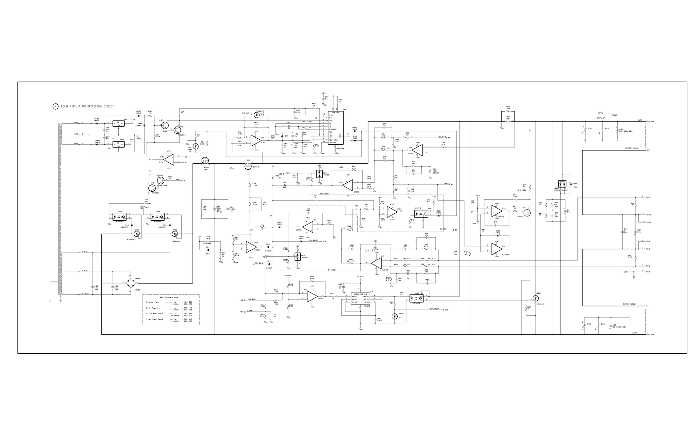

**Figure 1: Sheet A of the service manual, the whole power path on one page.**

**Read this before you trust the drawing.** Sheet A carries the label "8V/5, 20V/2.5A (50W)". It is the **50 W model's** sheet, not the 80 W one on my bench. The topology matches what I measured. Several component values do not.

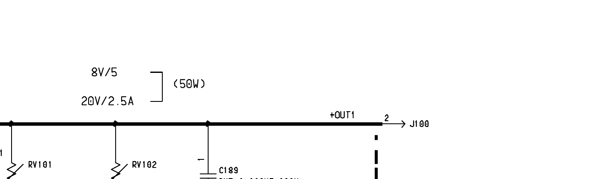

**Figure 2: The label that says this sheet is the 50 W version.**

Two I could confirm from the board photo: **R403 is marked 1623 (162K), the drawing says 220K**, and **R402 is marked 4531 (4.53K), the drawing says 3.83K**. R402 explains an August oddity: with 4.53K, the reference works out to 5.126 V x 4.53K / (10K + 4.53K) = 1.60 V, close to the 1.59 V I measured on pin 2. With the drawn 3.83K it would be about 1.4 V. Other values read from the board in August also differed from the drawing. Treat the drawing as a map, not a parts list.

### The control loop

The controller is **U400, an SG3525ADW**. Q400's gate is driven from its two outputs (pins 11 and 14) through a diode-OR. A sense amplifier, **U401**, watches the voltage across Q500 and feeds the result to pin 1 of the SG3525, with a TL431 (VR400) as a 2.5 V clamp. So the loop says: if Q500 has too much voltage across it, change the Q400 duty.

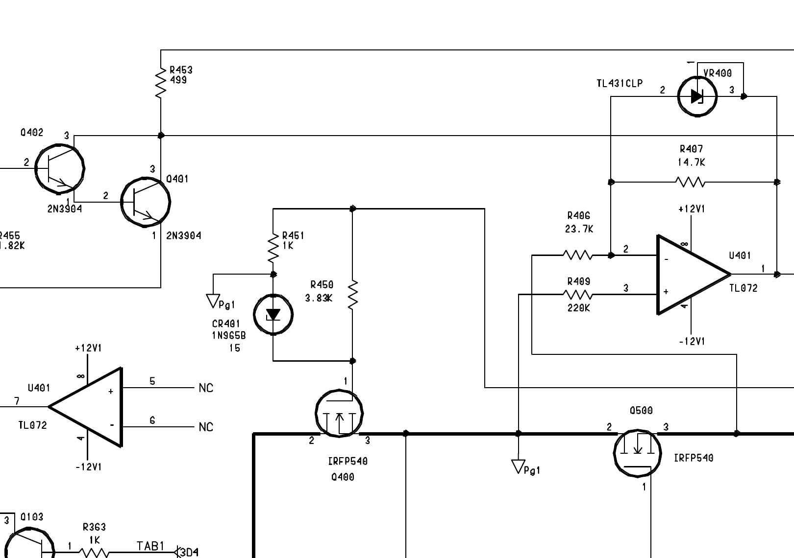

**Figure 3: Q400 gate network, U401 watching Q500, and the VR400 clamp.**

The part that matters for this story is the **timing node**:

- **Pin 5 (CT):** C401, printed "56p", to Pg1.
- **Pin 6 (RT):** R403 to Pg1.
- **Pin 7 (DISCHARGE):** R401, 499 ohm, to pin 5.

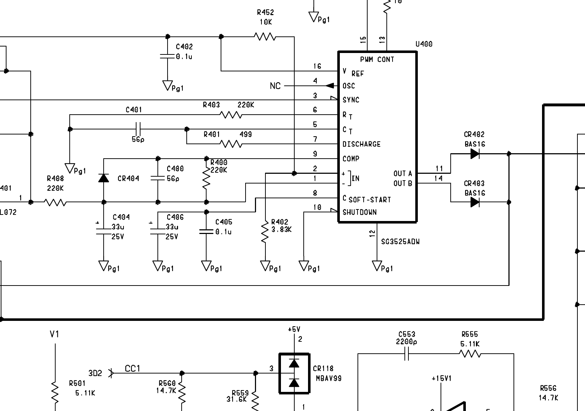

**Figure 4: The SG3525 with every pin. Timing parts on pins 5, 6 and 7, SYNC on pin 3.**

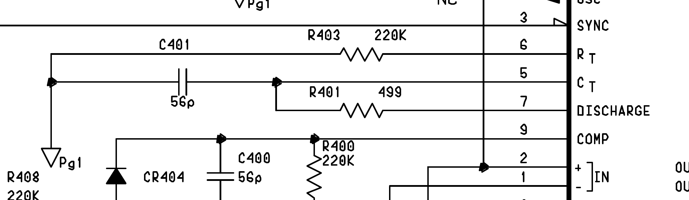

**Figure 5: Zoom on the timing node. The suspect is the small part on pin 5.**

One more note: sheet A has a legend saying parts numbered 600-699 are "Not Insert Parts". That covers an optocoupler path (U600, CR600). The board photo shows both footprints empty, so that feedback path does not exist on this unit.

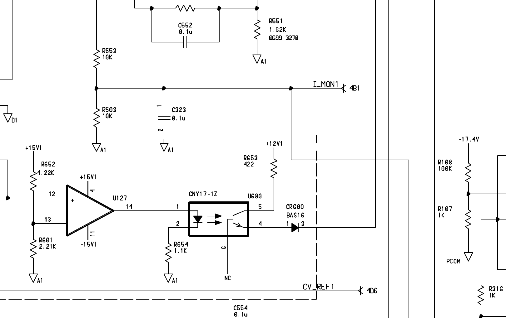

**Figure 6: The optocoupler option on the drawing. Not fitted.**

---

## Where to Probe (and One Safety Rule)

**Pg1 is a floating common.** It is not earth and not the output common. Clip your meter's black lead to the **tab of U402 (a 7812, tab = common)**. **Never use the tab of U403 next to it** - that is a 7912, and its tab is the negative input.

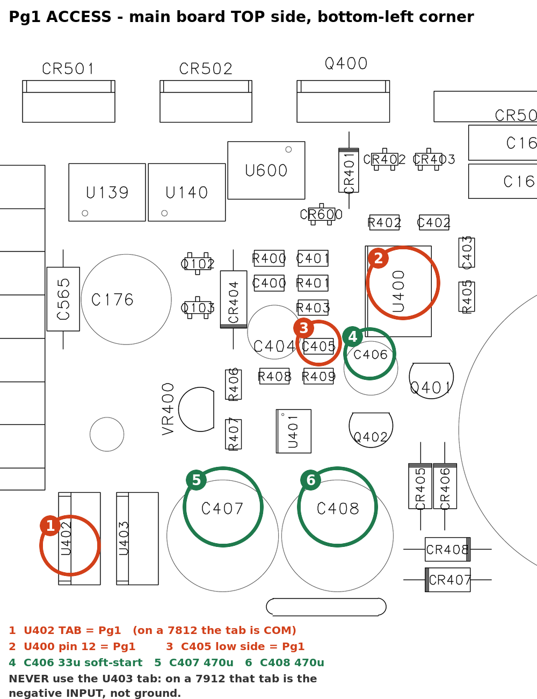

**Figure 7: Locator for the probe reference. Ring 1, the U402 tab, is Pg1. The green rings (C406, C407, C408) were the August electrolytic suspects.**

All readings below are to Pg1, unpowered where noted. "Bad boot" means Unreg with a dead output; "good boot" before the repair means the output came up. These are my readings on this one unit, not a spec.

| Point | What it is | Bad boot (before) | After the fix |
| --- | --- | --- | --- |
| Across C401, power off | Timing capacitor, in circuit | 302 ohm (Aug, one polarity); 252 / 251 ohm (Nov, probes swapped) | Not re-measured |
| U400 pin 5 | CT, timing node | 0.007 V (good boot: 0.0054 V) | 1.6 V DC |
| U400 pin 4 | OSC output | 6.3 mV on both boots | Not measured |
| U400 pin 6 | RT | 3.98 V | Not measured |
| U400 pin 1 | - input, from U401 | 0.953 V (good boot: 1.60 V) | 1.6 V |
| U400 pin 2 | + input, reference | 1.59 V | Not re-measured |
| U400 pin 9 | COMP | 5.76 V (good boot: 1.24 V) | Not measured |
| U400 pin 11 | OUT A | 0.0025 V (good boot: 11.28 V, stuck high) | 2.3 V DC |
| C503 | Main reservoir | -0.585 V | Not measured |

The row to remember: **pin 5 reads the same on a good and a bad boot before the repair.** That is not a sign of health. It is a sign of a dead oscillator on both.

---

## The Debug Story, August

This part rests on my debug log. The log held "five overturned final verdicts", listed below, plus one theory that died before any verdict. Every wrong turn came from a reasonable reading of the data I had at the time.

**The first theory: electrolytics.** Before measuring anything I assumed the bias browned out on a cold start and suspected C407/C408, C406 and C112/C116. On 2026-08-24 the bias rails measured fine and the SG3525 oscillator pin showed no ramp, so that died the same day.

**Verdict 1, the near-miss: "C401 has failed short."** With 302 ohm across C401 in circuit, I wrote "root cause found" and even specified a 56 pF C0G replacement. This was essentially right. But I retracted it the same day, because pin 5 also read 0.0054 V on a good boot.

**Verdict 2: "C401 is innocent."** Same reading on both boots, so the cap was cleared. The logic was backwards: the same reading on both boots meant the ramp was missing on both. Along the way I also read Q401/Q402 as an inverting gate driver and chased an optocoupler chain that is not even fitted.

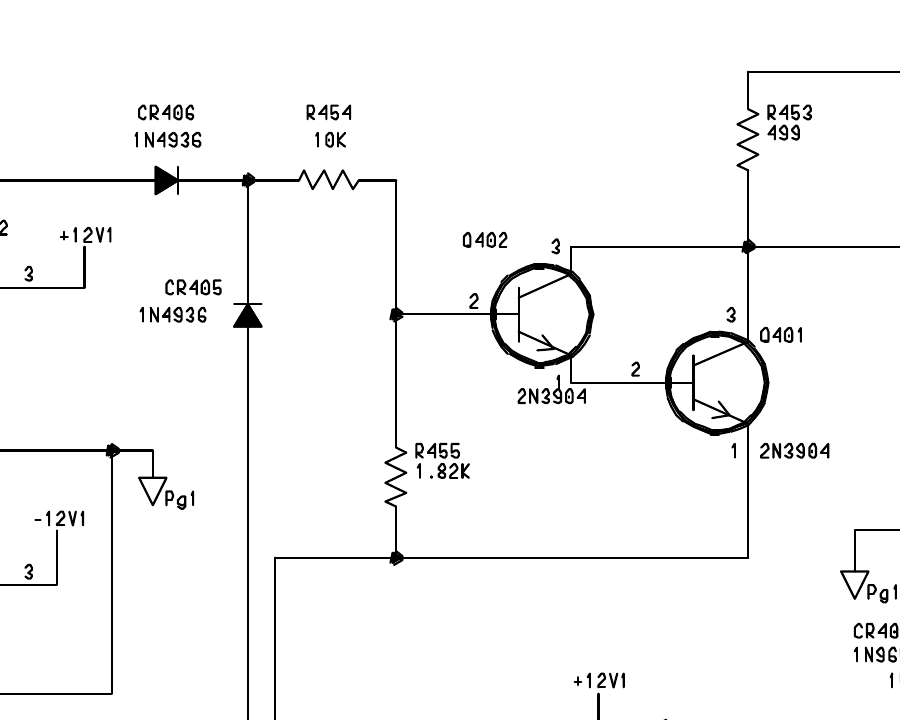

**Figure 8: Q401/Q402. The drawing shows a zero-crossing detector into SYNC, not a gate driver.**

**Verdict 3: "not a component fault."** Good and bad boots looked like two stable states of the loop, and the mains is low, so I called it a zero-margin loop tipped over by cold and low mains. The two states were real. But the "good" one was a fault state too: the pre-regulator was stuck on.

**Verdict 4: "a power-on race condition."** Pin 11 read 11.28 V on a good boot. I took that as 93 percent duty, so "the oscillator runs". But one SG3525 output cannot exceed about 49 percent duty. 11.28 V DC on a 12.1 V supply is an output stuck high.

**Verdict 5: "U400 is faulty, buy two."** On a failing start COMP was low and the gate stalled. I put the chip on the shopping list. They were never ordered, which was lucky.

| Verdict | Date | Why it was overturned |
| --- | --- | --- |
| C401 failed short | 2026-08-24 | Retracted when pin 5 matched on a good boot. It was right. |
| C401 innocent, fault upstream | 2026-08-24 | Same reading on both boots means a missing ramp on both. Optocoupler path not fitted. |
| Not a component fault, low mains | 2026-08-25 | The "good" boot was itself a fault state (pre-regulator stuck on). |
| Power-on race, 93 percent duty | 2026-08-25 | One output cannot exceed about 49 percent duty. |
| U400 is faulty | 2026-08-25 | Refuted in November: the same chip runs with a good timing cap. |

One entry was right and written down: on 2026-08-25 a review of the log said "C401 is BACK in the frame" and proposed reading it on the tester. I did not act on it for almost twelve weeks.

---

## The Debug Story, November

On 2026-11-15 I ran the tests that had been sitting in the log. From the first ohm reading to a regulating supply took about 73 minutes.

1. **Ohms across C401 in circuit, power off, probes swapped.** I got 252 and 251 ohm. The same both ways means a real resistive path, not a junction. It is also below R401's 499 ohm, so the leak is on the pin 5 node itself. About 25 uA of charge current into 252 ohm is about 6 mV, which matches the 5 to 7 mV seen on pin 5 in August. (That 25 uA is my estimate, not a measurement.)
2. **Lift C401.** I removed the part. The symmetric 252 ohm path was gone. Pin 5 to the U402 tab then read 45.32 kohm one way and 4.8 kohm the other, both drifting down. I had predicted megohms, so that guess was wrong. I took the remaining reading to be the unpowered chip's junctions.
3. **TC1 on the loose part.** It read **37 pF**, with about 22 kohm across it. The multimeter could not read the capacitance at all.
4. **Check the tester.** A 47 pF from my kit read **56 pF** on the same TC1. So the tester over-reads by about 9 pF at this size, and the old C401 was about **28 pF**, not 37. That is half the printed 56 pF. Either it lost capacitance as it failed, or this board uses a smaller value than the 50 W drawing. I cannot tell which.
5. **Fit a 47 pF.** I soldered a leaded 47 pF disc onto the C401 pads, leads trimmed short. Power-off checks for shorts looked fine.

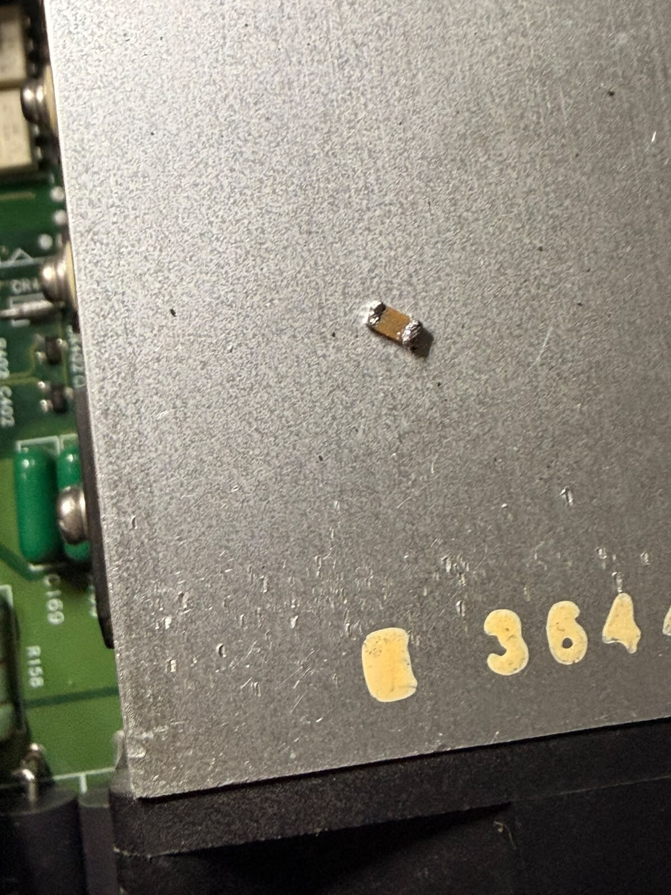

**Figure 9: The removed C401, a small chip capacitor on the heatsink.**

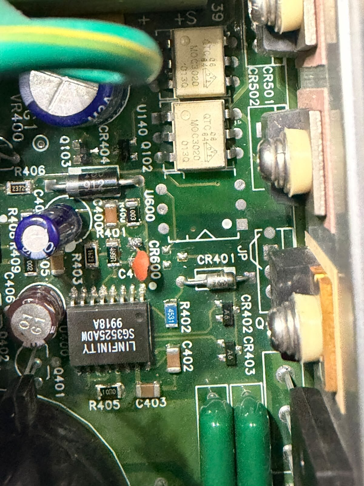

**Figure 10: The board after the fix. The orange disc standing on the C401 pads is the 47 pF.**

---

## Why a Few Picofarads Kill an 80 W Supply

Here is the chain, with the evidence kind marked in the wording.

- The SG3525 charges its timing capacitor through RT with only a small current. With a leak of a few hundred ohm in parallel, pin 5 stays near 0 V and **the timing ramp never rises**. This design also runs outside the datasheet's recommended RT and CT ranges, which makes the node very sensitive to leakage. That is my reading of the numbers.
- The datasheet block diagram shows the PWM latch is **reset only by the oscillator clock**. No ramp means no clock, so the output stage freezes in whatever state it powered up in.

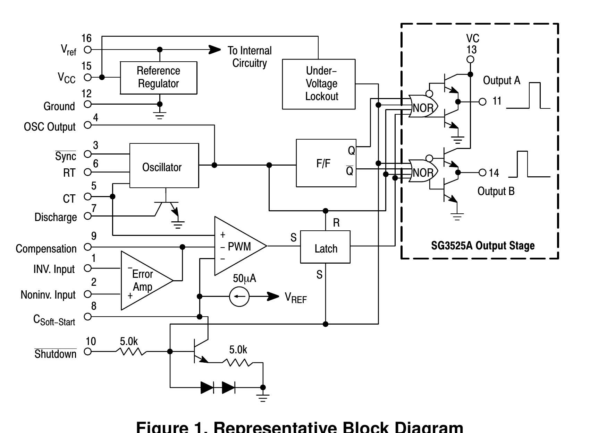

**Figure 11: SG3525A block diagram. The latch is reset only by the oscillator.**

- **SYNC cannot replace the ramp.** In the datasheet's oscillator schematic, SYNC shifts a comparator threshold. It does not generate the clock. This is my reading of the figure; I never scoped pin 3.

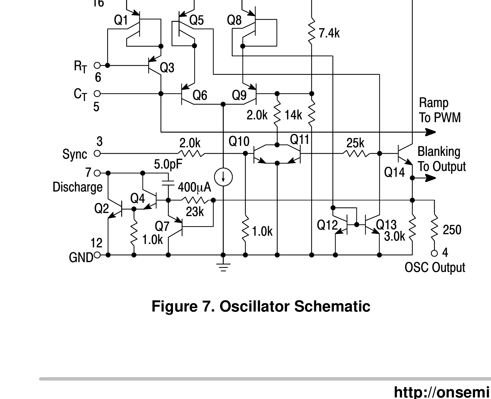

**Figure 12: SG3525A oscillator. SYNC acts on a threshold, not on the ramp.**

Two frozen states follow:

- **Frozen off:** Q400 never turns on, the reservoir never charges (-0.585 V measured), and the front panel shows **Unreg**.
- **Frozen on:** pin 11 sits at 11.28 V and Q400 is a closed switch. The supply "works", but Q500 does all the regulating and drops about **10 V** at 5 V out, no load (measured). That is far more than the few volts the design aims for. This state looked healthy and was a fault too.

### What is still not explained

- **Why some boots landed on and some off.** I never captured it. By the datasheet logic, a pin 5 clamped from the start should make every boot dead. Working boots existed, so the oscillator probably ran once and then stopped. The power-on scope capture that would show this was skipped once the capacitor was found.
- **Leak in the part, or under it.** The low reading left the board with the part. The loose part read about 22 kohm, not 250 ohm. So "the leak went away when C401 came off" is as far as I can honestly go.
- **Why it varied** (302 ohm in August, 252 ohm in November, streaky boots). My guess is temperature. A crack was suggested but never seen.

---

## The Result

On the first power-up after the fix (no load, 5 V set, output on):

- **No Unreg.**
- **Pin 5 = 1.6 V** DC, where a running ramp should average roughly 1.5 to 2 V on a DMM.
- **Pin 11 = 2.3 V** DC, instead of 11.28 V stuck high.

I am reading "oscillator running" from those DC values. **No scope was used**, so no waveform has been seen yet.

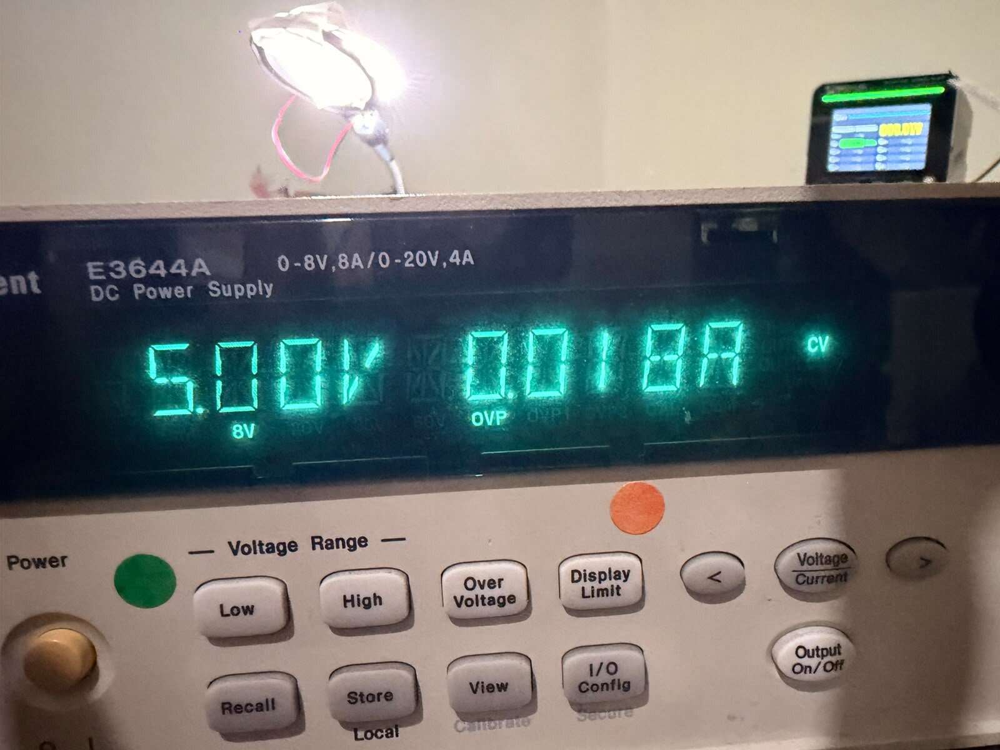

**Figure 13: After the repair: 5.001 V, 0.018 A, CV, no Unreg.**

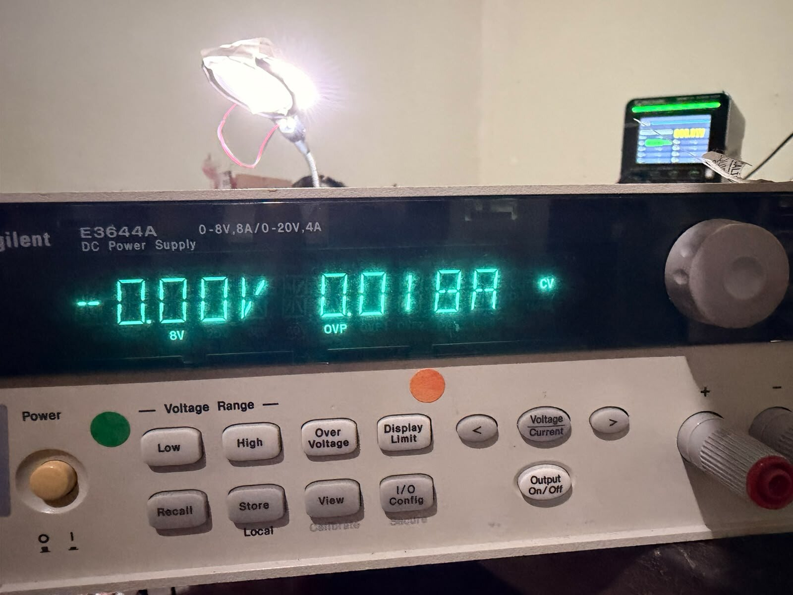

**Figure 14: Output at -0.001 V. The current display still says 0.018 A.**

That 0.018 A shows at both 0 V and 5 V with no load. It is probably the offset of the TL072 fitted at U122 in an earlier repair; the drawing calls for an AD706. The offset being the same at both voltages fits that explanation, but I have not proven it.

That earlier repair was a different fault. The supply gave no output and the display read about **12 A at 0 V**. The FORWARD BIAS video in the references shows that fix: replace the **AD706** current-sense op-amp at U122. I fitted a TL072 in its place, and it cleared that fault. The TL072 is not the specified part, so an AD706 goes back in before calibration.

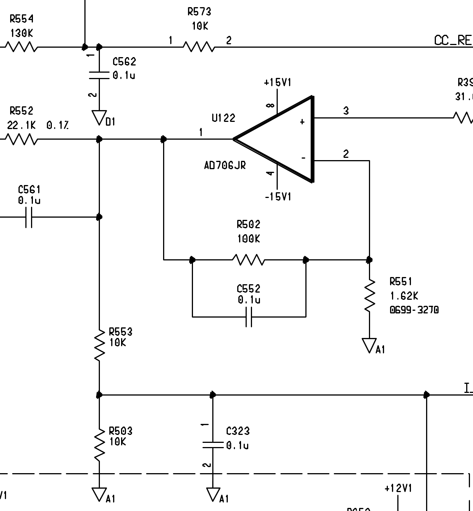

**Figure 15: U122, the current-sense amplifier. The drawing calls for an AD706JR; this unit has a TL072 there.**

---

## What Is Left

1. **20 cold starts**, at least three hours off between them, none showing Unreg. At three or four a day that is about a week. One good boot does not count.
2. **A scope on pin 5.** I want to see the ramp, not infer it from a DC reading.
3. **A load test.** Every reading after the repair is at no load.
4. **U122.** Fit an AD706 (SOIC-8), then recalibrate in this order: voltage, OVP, current.
5. **The permanent C401 value.** This is open. The 47 pF works for now. The drawing says 56 pF but is for the 50 W model, and the old part measured about 28 pF corrected. A surface-mount C0G part would be tidier than a disc standing on its leads. Do not knock it with the cover off.

Also open: **mains is about 200 V on the 230 V setting**, below the 207 V floor. Near full load Unreg could still appear because of that. That would be a different cause, and it is untested.

---

## Lessons

- **The same reading in the good and the bad state can mean the fault is present in both.** Pin 5 read millivolts on a working boot too. I read that as "capacitor innocent". It meant the oscillator was dead all the time.
- **Test the timing-capacitor node before blaming the controller.** Ohms with the probes swapped, then lift the part. I wrote this test down in August and did it in November. It saved buying two chips.
- **Check your component tester against a known part of the same size.** The TC1 read a 47 pF as 56 pF. Without that check I would have trusted 37 pF.
- **Know the chip's limits before reading a DMM voltage as duty cycle.** About 49 percent maximum per output means 11.28 V DC was a stuck output.
- **A supply that works can still be in a fault state.** The linear stage hid the stuck-on pre-regulator by dropping about 10 V.
- **Keep raw readings apart from verdicts, and check which model your drawing is for.** The log survived five reversals because the readings were kept verbatim. My notes had the wrong model, the drawing is the 50 W sheet, and the unit is the 80 W one.

---

## Safety

This supply has **mains inside**. The reservoir capacitors are large and can hold charge after power-off, so discharge them before touching anything. The **Pg1 domain floats**: use the U402 tab as the reference, never the U403 tab, and do not tie scope grounds to it casually.

---

## References

- [Service manual with schematics (Ed. 3, April 2000, E3640A-E3645A)](https://xdevs.com/doc/HP_Agilent_Keysight/HP%20E3640A,%2041A,%2042A,%2043A,%2044A,%2045A%20User.pdf) - sheet A is PDF page 199
- [Current Keysight E364xA User's and Service Guide](https://www.keysight.com/us/en/assets/9018-01165/user-manuals/9018-01165.pdf) - no schematics
- [SG3525A datasheet (onsemi)](https://www.onsemi.com/pdf/datasheet/sg3525a-d.pdf)
- [AD706 datasheet (Analog Devices)](https://www.analog.com/media/en/technical-documentation/data-sheets/ad706.pdf)
- Reference video: FORWARD BIAS, "#073 Agilent 20V 4A, Precision ... repair" (title partly in Sinhala). Covers the earlier 0 V / 12 A fault, fixed by replacing the AD706 op-amp at U122: [https://youtu.be/gn1Yev4GpD4](https://youtu.be/gn1Yev4GpD4)

Credits: schematic crops are from the Agilent manual (part number E3640-90001); datasheet figures are from the onsemi SG3525A data sheet.

---

**Next step:** power it cold, note whether Unreg shows, and log the boot as 1 of 20.
