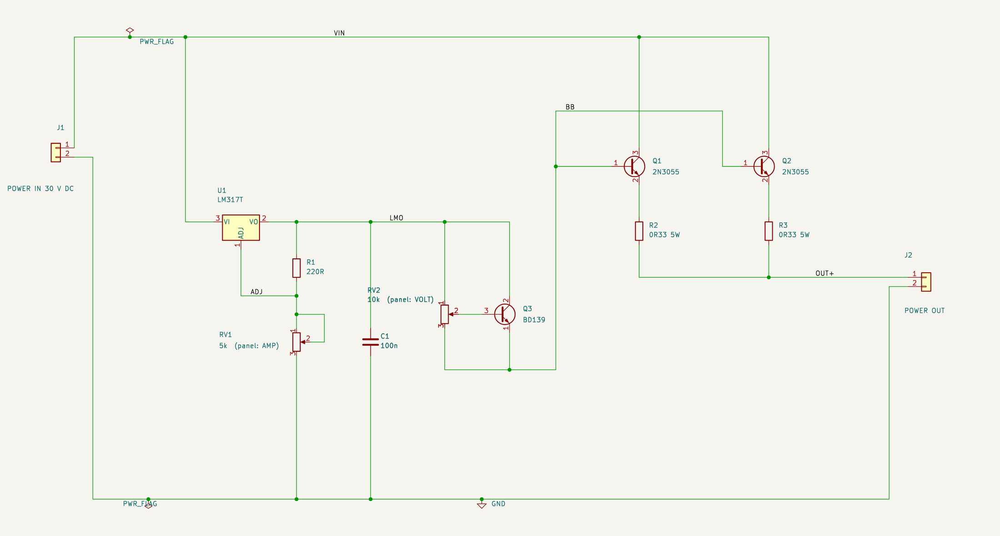
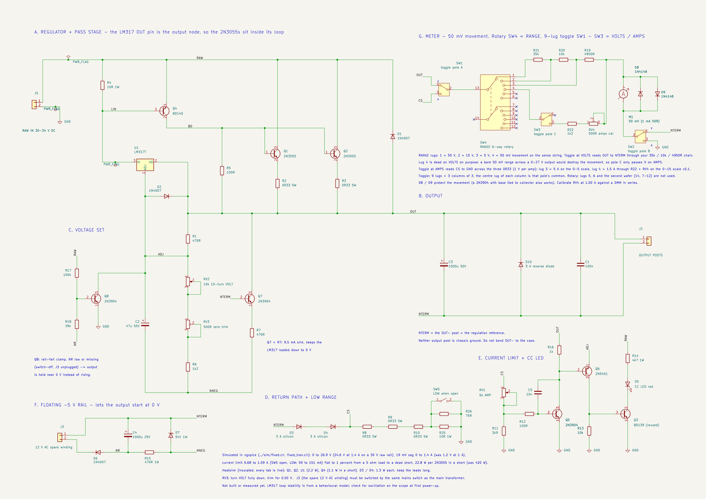
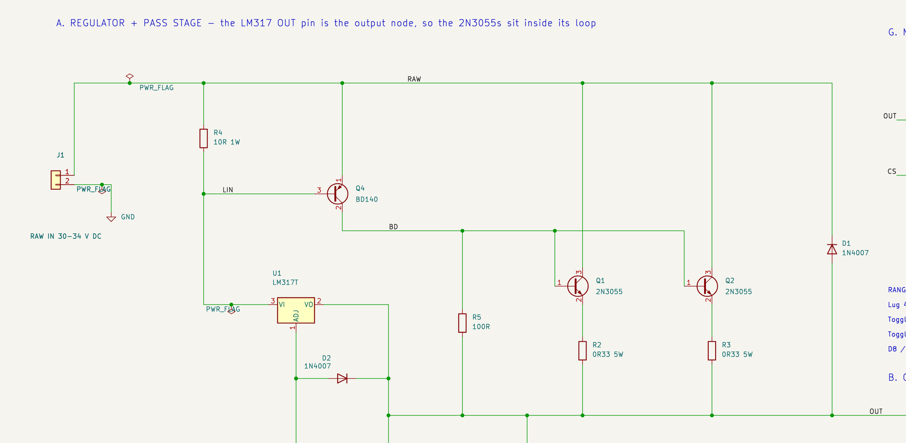
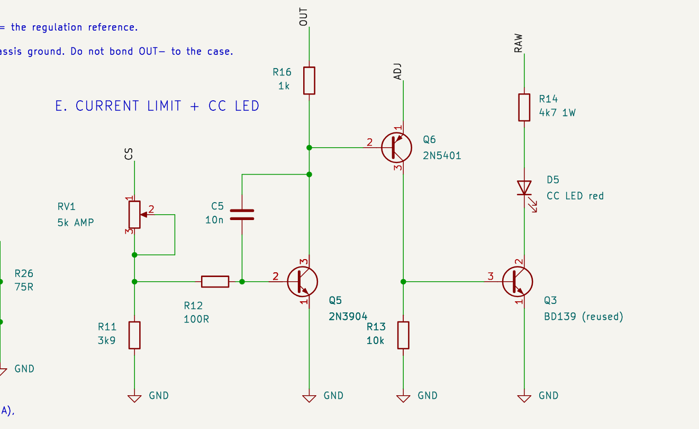
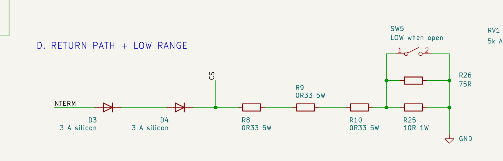
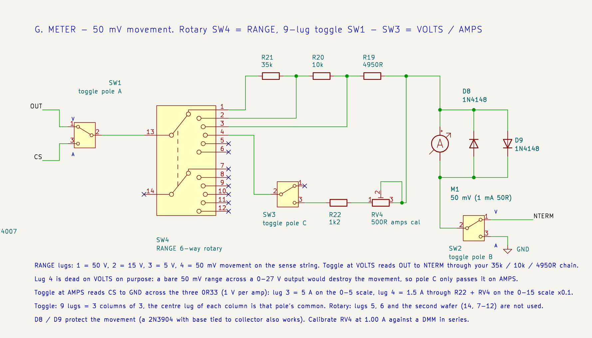

# LM317 + 2N3055 "0-30 V / 10 A" Supply: What the Wiring Picture Hid, and Seven Overturned Verdicts

I built the "Variable Power Supply 0-30V/10A" that circulates online from its wiring picture, then traced it into a schematic and simulated it. In simulation it is neither 0-30 V nor 10 A: the AMP knob limits nothing, a dead short draws 38 A, and the VOLT knob is not a voltage control. I drew a rework that, in ngspice only, holds 1.59 A in a short. **The rework is not built, and every number below comes from a simulation, not a meter.**

> **TL;DR**
>
> - **Finding:** the original circuit is on my bench. Traced from the picture and simulated, an output short draws 38 A and nothing senses current.
> - **Cause:** the 2N3055 pass transistors sit outside the regulation loop. The LM317 regulates its own pin, not the output terminal.
> - **Rework:** a pass stage inside the loop, a 0 V start, a low-side current limit and analog metering. Seven of my own first answers were overturned by the simulation along the way.
> - **Status: simulated only, NOT built.** Nothing of the rework is soldered or measured, and the LM317 model is a behavioural one I wrote, so loop stability on real parts is not proven.

---

## What I Built

The picture circulates online as "Variable Power Supply 0-30V/10A" with a tronicspro.com watermark. It is a pictorial of drawn parts and coloured wires, not a schematic. It shows one LM317T, one BD139, two 2N3055 in TO-3, two 0.33 ohm 5 W resistors, a 5k pot labelled AMP, a 10k pot labelled VOLT, one 220 ohm resistor, one 100 nF capacitor and a digital volt/amp panel meter, with the input marked +30 V.

It powered up. I wanted a debug note for "LM317 with pass transistor", had none, and traced the picture wire by wire into a schematic. It comes from the picture, not from the board.

---

## What the Schematic Showed

An LM317 with 220 ohm from OUT to ADJ and the 5k pot from ADJ to ground. LM317 OUT goes to the BD139 collector. The 10k pot is across the BD139 collector and emitter with its wiper on the base. The BD139 emitter feeds both 2N3055 bases, and each 2N3055 emitter goes through 0.33 ohm to the output. That is an LM317, a "rubber diode" (**Vbe multiplier**), then two emitter followers.

**Figure 1: The picture as a schematic. RV1 "AMP" is the LM317 divider; RV2 "VOLT" with Q3 is a Vbe multiplier.**

Three things in the picture are not what they claim:

- The 5k pot labelled AMP is the LM317 divider. It sets the output voltage and limits nothing. Simulated, it moves the no-load output from 1.1 to 28.0 V.
- The 10k pot labelled VOLT is the Vbe multiplier. With no load it changes the output by 0.0 V over its whole travel. Into a 20 ohm load it drags the output from 18.6 V down to 2.0 V.
- The picture wires the meter's voltage sense to the 2N3055 base bus, which sits 0.36 V (no load) to 1.62 V (5 A) above the real output.

---

## How Bad It Is, in Numbers

All of these are ngspice results at 30 V in, not meter readings.

| Test | Result |
|---|---|
| Output shorted | 38 A, about 420 W in each 2N3055, 39 W in the LM317 (at its own 2.0 A limit) |
| 12 V setting, no load to 1 A | 13.09 V falls to 11.90 V (1.19 V sag) |
| 2N3055 heat at 5 A, 12 V out | 44 W each. "10 A" was never real. |
| 12.6 V battery left on the output, mains off | 9.1 V reverse on the 2N3055 emitter-base junctions (rated 7 V) |

---

## The Rework

I kept the LM317, both 2N3055, both 0.33 ohm resistors, both pots, the 100 nF and the BD139 (new job). The topology comes from my own design note, written in August around the same parts. All of it is a schematic and simulations only.

**Figure 2: The whole rework on one sheet. The blocks are shown one at a time below.**

**Pass stage inside the loop.** The LM317 is fed through a 10 ohm 1 W resistor. A BD140 (PNP) has its emitter on the raw rail and its base on the LM317 input pin, so it turns on once the LM317 draws more than about 65 mA. Its collector drives the two 2N3055 bases. The LM317 OUT pin goes to the supply output, the joined ends of the two 0.33 ohm resistors, so it regulates the real output node and the big transistors just add current. At 1 A the LM317 itself carries 74 mA.

**Figure 3: Regulator and pass stage. The LM317 OUT pin is the output node.**

**Output starts at 0 V.** The voltage divider (470 ohm, a 10-turn 10k pot, a 500 ohm zero trimmer, 1.2k) returns to a floating -5 V rail made from a spare 12 V AC winding: one diode, 1000 uF, 470 ohm and a 5.1 V zener, with the positive side tied to the negative output terminal. That cancels the LM317's 1.25 V reference: 0 to 26.9 V at no load, 2.71 V per kilohm of pot.

**Low-side current sense.** Load current returns from the negative post through two silicon diodes and three 0.33 ohm resistors in series (0.99 ohm) to raw minus. The meter is **analog only**.

---

## What the Simulation Overturned

Each was a belief until the simulation disagreed.

### A. The current limiter from my August note was too soft

That note used one transistor pulling ADJ down. Simulated at a 12.2 V setting with the limit at 1.52 A, the output had already sagged to 11.36 V at 1.4 A, and the limit moved from 1.52 A (5 ohm load) to 1.61 A (dead short).

The fix is two transistors. A 2N3904 senses the voltage across the 0.99 ohm string through the AMP pot. Its collector load hangs from the output, not ADJ, so it cannot disturb the set voltage until it carries about 1.9 mA. A 2N5401 then pulls ADJ down. In simulation, 12.19 V holds at 1.4 A and the limit stays flat within 1 percent from a 5 ohm load to a dead short, over a 0.68 A to 1.59 A range.

**Figure 4: Current limit and CC LED. Q5 senses, Q6 pulls ADJ down, the reused BD139 lights the LED.**

### B. The sharper limiter fought the regulator

Without a capacitor on ADJ, a 0.1 A to 1 A load step sent the limiter and the LM317 chasing each other, and the output collapsed to 2.6 V under a load it should carry easily. A 47 uF capacitor on ADJ cures it in simulation. With only 47 uF on the output it still settled 0.36 V low, and with 1000 uF it dips 17 mV and settles cleanly. The cost: after the limit releases, the output takes about a second to recover.

### C. A dead short needs headroom the LM317 does not have

The LM317 output can only reach 1.25 V above the lowest point ADJ can reach, and with the sense resistors in the return lead a dead short left ADJ nowhere to go. Two silicon diodes in series with the return lift the negative post about 1.4 V above the sense node. With the diodes linked out, a short draws about 2.0 A at every knob position. They must be silicon, not Schottky.

**Figure 5: Return path: the two headroom diodes, the 0.99 ohm sense string, and the LOW range parts described further down.**

### D. Losing the -5 V rail raised the output

The small rail dies before the big reservoir. Simulated at a 5 V setting with no load, the output climbed to 12.9 V at switch-off and stayed up for seconds. The fix is a 2N3904 clamp on ADJ, biased by 100k from the raw rail and held off by 39k to the unregulated negative node, so it trips before the zener drops out. With it, the simulated output peaks at 5.09 V at switch-off, then falls.

### E. LM317 minimum load

The 470 ohm from OUT to ADJ passes 2.7 mA. The datasheet asks for 3.5 mA typical and 10 mA worst case. With a plain 2.7k bleeder the simulated output would not go below 2.3 V. The fix is a 2N3904 with 470 ohm in its emitter, sinking a constant 9.5 mA from the output into the -5 V rail.

### F. "The BD140 needs no heatsink"

My earlier note said so. It dissipates 1.1 W in a short, so it goes on the heatsink with the LM317 (2.2 W) and the 2N3055s (22.8 W each in a short at full limit).

### G. A reverse diode across the posts earns its place

If an outside source forces 3 A through the posts (a second supply, a motor), the limiter has no headroom below 0 V. Without the diode the supply is dragged to 2.8 A, 43 W per 2N3055. With a 3 A diode the output clamps at -0.8 V, the supply sits at 1.2 A and each 2N3055 sees 18 W.

Two traps in my own model gave plausible wrong answers: a loosened convergence tolerance returned operating points that violated Kirchhoff's current law, and a subcircuit port named `gnd` silently became the global ground. Check odd results by hand.

---

## The Meter

I redrew the meter three times because I kept drawing what my old note said, not what was in the drawer. The note assumed a 0-15 scale on a 3-position rotary switch; the drawer held one 50 mV movement, three multiplier resistors (4950 ohm, 10k, 35k), a 6-position rotary switch and a toggle switch with 9 lugs.

**Figure 6: The meter I could build from the drawer.**

4950 ohm for a 5 V range means the movement is 1 mA and 50 ohm; the three resistors in series give 5 V, 15 V and 50 V. The 9-lug toggle is a 3-pole 2-way switch choosing **VOLTS or AMPS**; the rotary picks the range. The bare 50 mV movement is deliberately dead on VOLTS, since 50 mV full scale across 0 to 27 V would destroy it. On AMPS it reads the sense string and becomes a 1.5 A range.

Simulated: a true 12.21 V reads 12.22 V on the 50 V range (full output is 54 percent of scale) and 12.21 V on the 15 V range. A true 1.02 A reads 1.02 A on the 5 A range and 1.03 A on the 1.5 A range.

---

## A LOW Current Range

I added a 10 ohm 1 W resistor with 75 ohm across it, in series with the sense string and shorted by a toggle for HIGH. The pair is 8.82 ohm; added to 0.99 ohm that is 9.81 ohm, almost exactly ten times the string, so the limit and both amps ranges drop to one tenth. The LOW limit range is 59 to 151 mA. One wart: on LOW the meter also counts the supply's own 13 mA, so a true 102 mA reads 112 mA.

---

## The Result: As Built Against the Rework

Read the right-hand column as "on paper".

| Test | As built | Rework (simulated) |
|---|---|---|
| Output range, no load | 1.1 to 28.0 V | 0 to 26.9 V |
| Top of range at 1.4 A | not regulated | 26.9 V on a 34 V raw rail, 24.6 V on 30 V |
| 12 V setting, 0 to 1 A | sags 1.19 V | sags 0.018 V |
| Output shorted | 38 A, 420 W per 2N3055 | 1.59 A, 22.8 W per 2N3055 |
| Current limit | none | 0.68 to 1.59 A, or 59 to 151 mA on LOW |
| Battery left on, mains off | 9.1 V reverse on the 2N3055 emitter-base | 0.01 V, 2.1 mA drain |

The limit follows a transistor's Vbe, so the model says it drifts down when warm: 0.68 A at 27 C, 0.64 A at 50 C, 0.59 A at 75 C at the minimum setting.

16 ngspice decks, about 240 logged results; every number here comes from that log. Both schematics were drawn in KiCad from scripts and compared pin by pin with the simulated netlist (30 pins on 9 nets as built, 140 pins on 36 nets for the rework), ERC 0 errors.

---

## What Is Left

The rework is a schematic and simulations, and every claim above stays "in simulation" until a meter says otherwise.

1. **Build it.** Nothing is soldered yet.
2. **First power-up** from a current-limited bench supply at 20 V, 150 mA limit. Expect about 13 mA.
3. **Check the -5 V rail** (5.2 V below the negative post) and trim zero.
4. **Before raising the limit:** with a 100 ohm load, 2N3055 base-to-emitter should read about 0.56 V.
5. **Scope on the posts** at no load, 0.5 A and in current limit; the stability claim rests on a model.
6. **Calibrate the amps trimmer** at 1.00 A against a DMM.
7. **Identify the diodes.** Five come from salvaged stock of unrecorded type. If they cannot be identified, buy 3 x 1N4007 and 2 x 1N5408.

---

## Lessons

- **A wiring picture is not a schematic.** Redrawing it took an hour and found every fault before more solder did.
- **Knob labels are a claim, not a fact.** One sweep per knob settles it.
- **A regulator only regulates the node it can see.** Pass transistors after the sense point are outside the loop.
- **Simulate switch-off, not just steady state.** The worst fault (5 V becoming 12.9 V) exists only for seconds after the mains switch.
- **Report the fixes that failed.** The single-transistor limiter and the missing ADJ capacitor explain the final parts list.
- **Draw what is in the drawer, not what is in the old note.**

---

## Safety

This supply has **mains inside**. Every power tab is live and at a different potential (LM317 tab = output, 2N3055 case = collector on the raw rail, BD140 tab = collector), so each needs its own insulator. Neither output post is chassis ground, and bonding the negative post to the case bypasses the sense resistors and removes the current limit. The spare winding for the -5 V rail must be switched by the same mains switch as the main transformer. Reservoir capacitors hold charge.

---

## References

- [LM317 datasheet (Texas Instruments)](https://www.ti.com/lit/ds/symlink/lm317.pdf) - minimum load current and current limit
- [2N3055 datasheet (onsemi)](https://www.onsemi.com/pdf/datasheet/2n3055-d.pdf) - emitter-base voltage rating
- The original wiring picture: "Variable Power Supply 0-30V/10A", watermarked tronicspro.com.
- [Agilent E3644A "Unreg" on cold start](/article/agilent-e3644a-unreg-cold-start-repair) - the bench supply used for bring-up
- [The 1981 "Indestructible" bench power supply](/article/indestructible-bench-power-supply) - another LM317 supply

Credits: schematics drawn in KiCad, simulated in ngspice.

---

**Next step:** build the rework, power it from the bench supply at 20 V with a 150 mA limit, and see whether it draws about 13 mA.
